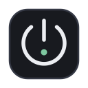
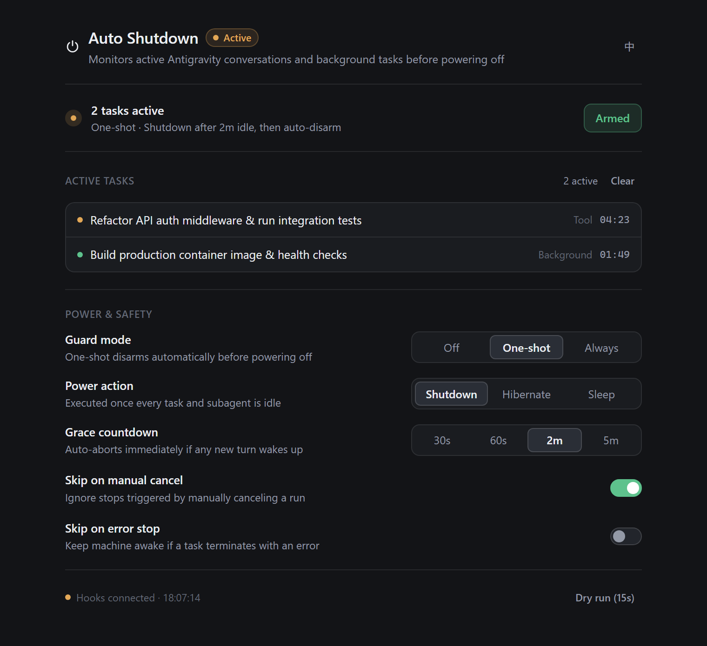
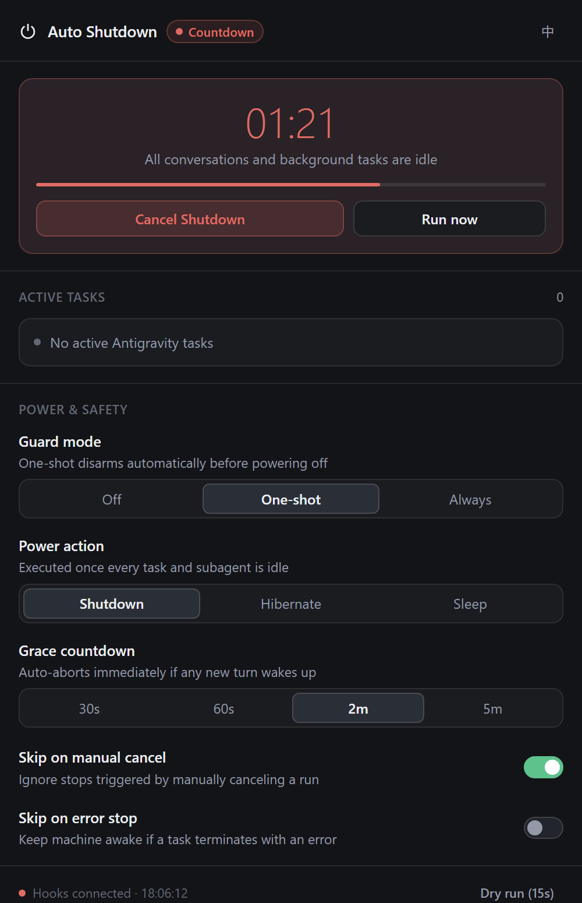
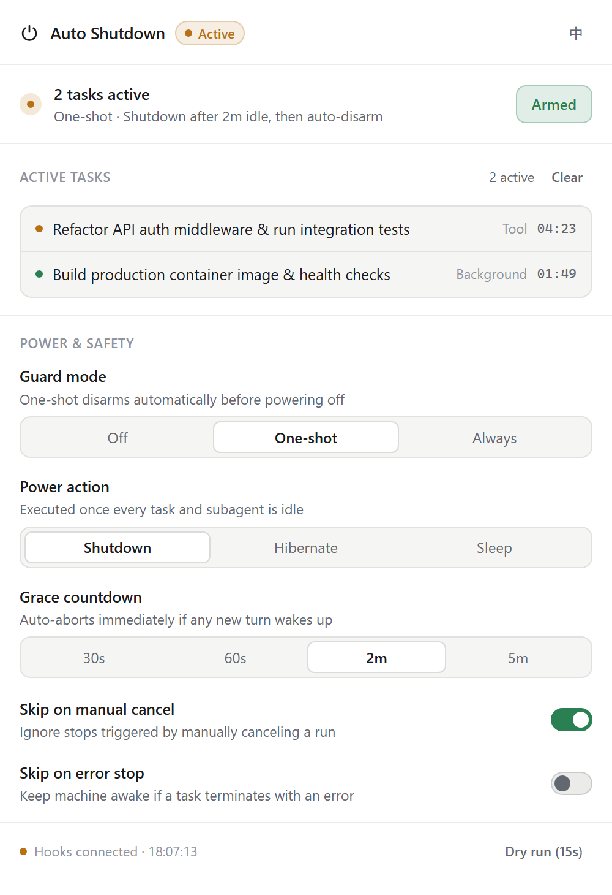
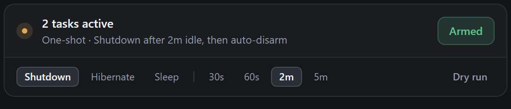

<div align="center">
  
  <h1>Auto Shutdown for Antigravity</h1>
  <p>
    <strong>Native-styled auto-shutdown guard built directly into Antigravity.</strong><br/>
    Tracks every parallel conversation and background task via official lifecycle hooks, then gracefully shuts down, hibernates, or sleeps your machine once all work is truly idle — rendered inside Antigravity's own Side Panel, Left Sidebar, and Chat stream with zero foreign chrome.
  </p>

  <p>
    <a href="README.zh-CN.md">简体中文</a> ·
    <a href="#preview">Preview</a> ·
    <a href="#installation">Installation</a> ·
    <a href="#how-it-works">How It Works</a> ·
    <a href="#cli--skill-commands">CLI &amp; Skill</a> ·
    <a href="CHANGELOG.md">Changelog</a>
  </p>

  <p>
    
    
    
    
  </p>
</div>

---

## Preview

Designed to feel **indistinguishable from a native Antigravity feature**: inherits Antigravity's live host theme tokens (`--color-background-*`, `--color-text-*`, `--color-border-*`, `--font-sans`) with `prefersBorder: false` and switches cleanly between Dark & Light modes and `中文 / EN`.

<div align="center">
  <p><strong>Full-Page Sidebar View (Left Sidebar → Plugins → Auto Shutdown)</strong></p>
  
</div>

<br/>

<div align="center">
  <table>
    <tr>
      <td align="center"><strong>Side Panel · Dark (Countdown)</strong></td>
      <td align="center"><strong>Side Panel · Light (Active Tasks)</strong></td>
    </tr>
    <tr>
      <td align="center"></td>
      <td align="center"></td>
    </tr>
  </table>
</div>

<br/>

<div align="center">
  <p><strong>Inline Chat Card (Rendered inside conversation stream)</strong></p>
  
</div>

---

## Where to Open It in Antigravity

Once installed, Auto Shutdown integrates directly into Antigravity's native chrome:

1. **Side Panel (`aux_pane`)** — Click **`+`** in the Side Panel (or **Overview → Plugins → Auto Shutdown**) to dock it right beside your active chat.
2. **Left Sidebar (`global`)** — Open **Plugins → Auto Shutdown** in the left sidebar for a clean Settings-style full view.
3. **Inline in Chat** — Run `/auto-shutdown` or ask *"show Auto Shutdown status"* / *"arm auto-shutdown after tasks finish"*.
4. **Optional Standalone Desktop Pill (Windows)** — If you also want a minimalist floating pill above the Windows taskbar while Antigravity is minimized, run `node scripts/ctl.mjs ui` anytime.

---

## Features

- **Accurate Multi-Task & Background Detection** — Uses Antigravity's official `hooks.json` (`SessionStart`, `PreInvocation`, `PostToolUse`, `PostInvocation`, `Stop`) without altering or weakening tool permissions (`PreToolUse` is untouched). Respects `fullyIdle` so background commands, timers, and subagents keep the session alive until every job completes.
- **Multi-Conversation Safe** — Tracks all parallel Antigravity conversations concurrently with cross-process file locking and atomic JSON writes. Countdown begins only when **every** tracked session has finished.
- **Anti-Misfire Guardrails**
  - **One-shot by default**: Disarms itself *before* issuing the OS power command so your next boot starts cleanly disarmed.
  - **Grace countdown + Instant auto-cancel**: Defaults to a 120-second grace window (`30s / 60s / 2m / 5m`). If any new turn, tool call, or reactive subagent wakes up during the countdown, it aborts automatically.
  - **Skip on manual cancel / error**: Toggleable guardrails for `USER_CANCELED` and `ERROR` terminations.
  - **Stale session pruning**: Auto-expires abandoned/crashed tabs using activity timestamps and `transcriptPath` mtime checks.
  - **Safe Dry-Run Preview**: Built-in `Dry run (15s)` button lets you test the entire countdown & cancel flow without ever powering off.
- **Zero Runtime Dependencies** — Runs on pure Node.js ESM (`>= 18`) with a pre-bundled single-file MCP App UI (`ui/app.html`), working out of the box across **Windows, macOS, and Linux** without `npm install`.

---

## Installation

### Option 1: Antigravity CLI (Recommended)

```bash
git clone https://github.com/lzcc20/antigravity-auto-shutdown.git
agy plugin install ./antigravity-auto-shutdown
```

### Option 2: One-Click Install Scripts

**Windows**
```cmd
git clone https://github.com/lzcc20/antigravity-auto-shutdown.git
cd antigravity-auto-shutdown
install.bat
```

**macOS / Linux**
```bash
git clone https://github.com/lzcc20/antigravity-auto-shutdown.git
cd antigravity-auto-shutdown
sh install.sh
```

> User settings and runtime state are stored separately at `~/.gemini/config/auto-shutdown/`, so updating or reinstalling preserves your preferences.

### Uninstall

Run `uninstall.bat` (Windows), `sh uninstall.sh` (macOS/Linux), or uninstall directly from Antigravity's **Customizations** page.

---

## How It Works

```text
Antigravity Lifecycle Hooks                     Antigravity Native MCP App UI
───────────────────────────                     ─────────────────────────────
PreInvocation / PostToolUse ──▶ engine.mjs ◀──▶ mcp-server.mjs (ui://auto-shutdown/app.html)
                                     │          · Left Sidebar (global full page)
Stop (fullyIdle: false)     ──▶ keep active     · Side Panel (aux_pane tab)
Stop (fullyIdle: true)      ──▶ remove session  · Inline Chat Card
                                     │          · Auto host dark/light CSS tokens
                     activeSessions == 0 && armed?
                                     │
                                     ▼
                         countdown-worker.mjs
                         · Re-checks state every 500ms
                         · Auto-aborts on any new task
                         · Disarms one-shot BEFORE power off
                         · Executes shutdown / hibernate / sleep
```

> **Tip for overnight runs**: Pair Auto Shutdown with Antigravity's `/goal` command when running long unattended jobs, and arm **One-shot** (`单次布防`) right before stepping away. Note that conversations already running *before* the plugin was enabled won't be registered until their next hook event.

---

## CLI & Skill Commands

In Antigravity chat, invoke `/auto-shutdown` or ask naturally (*"open the Auto Shutdown panel"*, *"arm one-shot auto-shutdown after tasks finish"*).

From a terminal (inside the plugin folder):

| Command | Description |
| --- | --- |
| `node scripts/ctl.mjs status` | Show guard status, active tasks, and countdown state |
| `node scripts/ctl.mjs arm --mode once --action shutdown --grace 120` | Arm one-shot auto-shutdown with 120s grace period |
| `node scripts/ctl.mjs arm --mode continuous --action hibernate --grace 60` | Arm continuous hibernate guard |
| `node scripts/ctl.mjs disarm` | Disarm guard and cancel any active countdown |
| `node scripts/ctl.mjs cancel` | Cancel current countdown immediately |
| `node scripts/ctl.mjs preview --seconds 15` | Run a safe 15s dry-run preview (never powers off) |
| `node scripts/ctl.mjs clear-stale` | Clear tracked sessions manually |
| `node scripts/ctl.mjs ui` | Optional: open standalone Windows bottom-right desktop pill |

---

## Configuration

Stored at `~/.gemini/config/auto-shutdown/config.json`:

| Field | Default | Values / Notes |
| --- | --- | --- |
| `armed` | `false` | Whether the guard is currently armed |
| `mode` | `"once"` | `"once"` (auto-disarms before execution) or `"continuous"` |
| `action` | `"shutdown"` | `"shutdown"`, `"hibernate"`, or `"sleep"` |
| `graceSeconds` | `120` | Countdown buffer in seconds (`10`–`3600`) |
| `ignoreUserCancel` | `true` | Skip countdown when `terminationReason === "USER_CANCELED"` |
| `ignoreErrors` | `false` | Skip countdown when `terminationReason === "ERROR"` |
| `staleTimeoutMinutes` | `15` | Auto-prune inactive sessions beyond N minutes (also checks transcript mtime) |
| `language` | `"zh-CN"` | `"zh-CN"` or `"en"` |
| `dryRun` | `false` | Simulate power actions without shutting down |

---

## Development & Testing

```bash
# Run engine & MCP App server tests
node --test tests/engine.test.mjs tests/mcp.test.mjs

# Validate Antigravity plugin manifest, MCP config & hooks strictly
agy plugin validate --strict .
```

See [CONTRIBUTING.md](CONTRIBUTING.md) and [THIRD-PARTY-NOTICES.md](THIRD-PARTY-NOTICES.md).

## License

[MIT](LICENSE) © 2026 lzcc20
