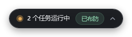
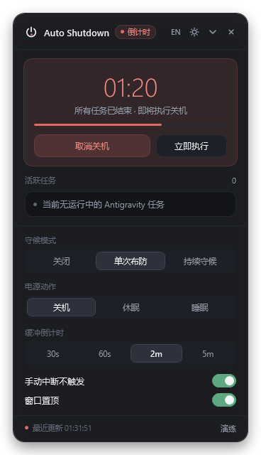
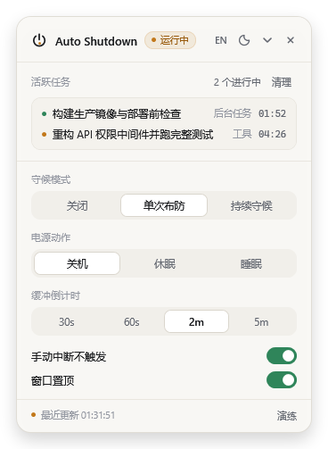

<div align="center">
  
  <h1>Auto Shutdown · 反重力自动关机插件</h1>
  <p>
    <strong>专为 Antigravity 长时间挂机任务打造的极简高级自动关机守卫。</strong><br/>
    基于 Antigravity 官方生命周期钩子实时监测所有并行会话与后台任务，确认全部空闲后倒计时执行关机 / 休眠 / 睡眠；搭配常驻桌面右下角的克制悬浮胶囊与展开控制卡片。
  </p>

  <p>
    <a href="README.md">English</a> ·
    <a href="#安装方式">安装方式</a> ·
    <a href="#工作原理与防误关设计">防误关设计</a> ·
    <a href="#命令行与对话控制">对话与命令行</a> ·
    <a href="CHANGELOG.md">更新日志</a>
  </p>

  <p>
    
    
    
    
  </p>
</div>

---

## 界面预览

朴素克制的哑光质感，默认静静贴合在**屏幕右下角任务栏上方**——平时折叠为一颗低干扰胶囊，点击向上展开为完整控制卡片；自动跟随 Windows 深浅色模式，并支持一键切换 `中 / EN` 与系统托盘收纳。

<div align="center">
  <p><strong>右下角极简悬浮胶囊</strong></p>
  
</div>

<br/>

<div align="center">
  <table>
    <tr>
      <td align="center"><strong>深邃哑光黑（倒计时状态）</strong></td>
      <td align="center"><strong>温润纸感浅色（多任务监控中）</strong></td>
    </tr>
    <tr>
      <td align="center"></td>
      <td align="center"></td>
    </tr>
  </table>
</div>

---

## 核心特性

- **精准识别多会话 & 后台任务**：基于 Antigravity 官方 `hooks.json`（`SessionStart`、`PreInvocation`、`PostToolUse`、`PostInvocation`、`Stop`），完全不干涉工具权限审批（不拦截 `PreToolUse`）；严格读取 `Stop` 的 `fullyIdle` 字段，只要仍有后台命令、定时器或子代理在跑就不会提前关机。
- **并行任务并发安全**：采用跨进程文件锁 + 原子 JSON 写入，哪怕同时运行多个并行会话或 Swarm 代理，也只有当**所有**活跃任务都清空时才会进入倒计时。
- **多重防误关机保护**
  - **默认单次布防（One-shot）**：触发关机*之前*自动解除布防，确保下次开机正常对话不会意外关机。
  - **缓冲倒计时 + 唤醒自动撤回**：默认 2 分钟缓冲（支持 `30s / 60s / 2m / 5m`），期间一旦有任何新对话、工具调用或子代理唤醒，立刻自动取消倒计时。
  - **手动中断不触发**：支持忽略 `USER_CANCELED`，调试途中手动点停不会误关机。
  - **僵尸会话自动清理**：结合活跃时间与 `transcript.jsonl` 修改时间自动淘汰意外关闭的残余会话。
  - **安全演练模式**：卡片底部自带 `演练` 按钮，一键体验完整 15 秒倒计时与取消交互，绝不真正关机。
- **零外部依赖、超轻量**：核心引擎使用纯 Node.js ESM（无需 `npm install`），Windows 右下角悬浮窗与托盘图标直接使用系统内置 WPF，秒启且内存占用极低。
- **自然语言 & 斜杠命令控制**：内置 `/auto-shutdown` Skill，在反重力对话里直接说“开启任务完成后自动关机”或“打开右下角关机悬浮窗”即可控制。

---

## 安装方式

### 方式一：通过 Antigravity CLI 安装（推荐）

```bash
git clone https://github.com/lzcc20/antigravity-auto-shutdown.git
agy plugin install ./antigravity-auto-shutdown
```

### 方式二：一键安装脚本

**Windows**
```cmd
git clone https://github.com/lzcc20/antigravity-auto-shutdown.git
cd antigravity-auto-shutdown
install.bat
```

**macOS / Linux**
```bash
git clone https://github.com/lzcc20/antigravity-auto-shutdown.git
cd antigravity-auto-shutdown
sh install.sh
```

> 个人偏好与运行状态保存在 `~/.gemini/config/auto-shutdown/`，更新或重装插件不会丢失配置。

### 卸载

运行 `uninstall.bat`（Windows）或 `sh uninstall.sh`（macOS / Linux），或在 Antigravity 的 **Customizations** 插件页直接卸载。

---

## 工作原理与防误关设计

1. 任意对话开始推理（`PreInvocation`）或工具完成（`PostToolUse`）时，登记该 `conversationId` 为活跃状态；如果当时正处于倒计时，**立即取消关机**。
2. 对话结束触发 `Stop` 时：
   - 若 `fullyIdle === false`：说明仍有后台任务在运行，标记为“后台任务等待中”，不关机；
   - 若 `fullyIdle === true`：注销该会话，并检查全局是否还有其他并行会话仍在运行。
3. 当活跃会话数归零且处于布防状态时，启动独立后台倒计时进程（`countdown-worker.mjs`），每秒复核状态文件，倒计时归零前自动解除单次布防，随后执行 `关机` / `休眠` / `睡眠`。

> **挂机建议**：夜间跑大型任务时，可以配合反重力内置的 `/goal` 命令，并在任务开始前在右下角胶囊里点一下**「布防」**。注意：在启用插件*之前*就已经在跑的对话，要等到它下一次触发钩子时才会被登记。

---

## 命令行与对话控制

在 Antigravity 对话框中可直接使用 `/auto-shutdown`，或在终端执行：

| 命令 | 说明 |
| --- | --- |
| `node scripts/ctl.mjs status` | 查看当前守卫状态、活跃任务与倒计时 |
| `node scripts/ctl.mjs arm --mode once --action shutdown --grace 120` | 开启单次布防（2 分钟倒计时后关机） |
| `node scripts/ctl.mjs arm --mode continuous --action hibernate --grace 60` | 开启持续守候（60 秒后休眠） |
| `node scripts/ctl.mjs disarm` | 关闭布防并取消当前倒计时 |
| `node scripts/ctl.mjs cancel` | 仅取消当前倒计时 |
| `node scripts/ctl.mjs ui` | 打开 / 唤起右下角悬浮窗（Windows） |
| `node scripts/ctl.mjs ui --expanded` | 直接以展开卡片模式打开悬浮窗 |
| `node scripts/ctl.mjs preview --seconds 15` | 启动 15 秒安全演练倒计时（不关机） |
| `node scripts/ctl.mjs clear-stale` | 手动清理残留的活跃任务记录 |

---

## 本地测试与校验

```bash
# 运行核心状态机单元测试
node --test tests/engine.test.mjs

# 使用 Antigravity 官方校验器严格检查插件
agy plugin validate --strict .
```

## 开源协议

本项目基于 [MIT License](LICENSE) 开源。
